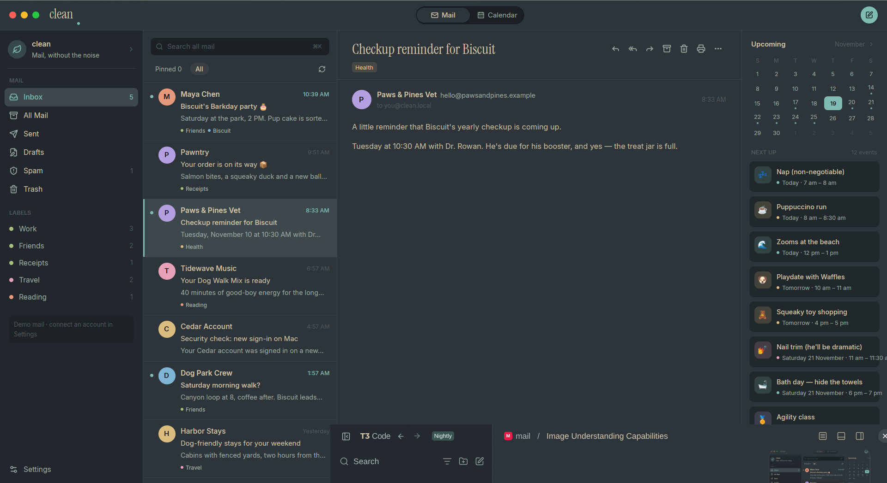

# clean

**Mail, without the noise.** A calm, private, native mail client for Omarchy.

Built in Rust with [GPUI Kit](https://gpui-kit.com). Three theme modes — **White**,
**Black**, and **Omarchy** (live desktop palette) — plus a first-run appearance and
account setup.



## Features

- Three-pane mail layout with an Upcoming calendar rail, modelled on the reference UI.
- Optional unified inbox: merge every account's incoming mail into one "All Inboxes"
  view. Disabled by default; enable it under Settings → Accounts.
- White / Black / Omarchy themes with nine accent colours. Blue is the default and
  follows Omarchy's live blue token; in Omarchy mode the app re-skins itself when the
  desktop theme changes.
- First-run setup: appearance → connect account. Reachable later from Settings → Accounts.
- Google (OAuth 2.0 Desktop client), iCloud Mail (app-specific password), and Proton
  (via Proton Mail Bridge) account support.
- Search across the whole mailbox on the server (IMAP `SEARCH TEXT`) with instant
  local FTS results shown first; results are deduplicated and cached on open.
- Local-first: SQLite cache with FTS5 full-text search, credentials in the GNOME/Secret
  Service keyring, no telemetry.
- IMAP sync with IDLE for instant new mail, lazy body fetching, mark-as-seen, and
  real message actions mirrored to the server. Each sync also reconciles the
  local cache: messages expunged or flagged in another client are removed or
  updated, and a changed UIDVALIDITY rebuilds that folder's cache.
- Attachments: decode and cache files from incoming mail, open with the desktop
  default app or save to Downloads, and attach local files when composing (file
  picker or paste a path). Sent copies and drafts include the same files.
- Inline reply/compose with To/Cc/Bcc, reply-all that excludes your own address,
  autosaved and resumable drafts, and files attached from the picker or a path.
- Calendar with a New Event sheet and one-click "add to calendar" from a detected
  date in a message. Optional two-way CalDAV sync: configure URL, username and
  app password under Settings → Calendar. Events added or deleted locally are
  pushed to the server, remote changes are pulled, and ETags are used for safe
  updates. A background sync runs every 5 minutes (configurable).
- Custom-drawn window chrome, spring animations and keyboard navigation.
- Snooze: hide a message from its inbox until later today, tomorrow or next week;
  it returns to the list with a desktop notification. The Snoozed folder lists
  pending messages (state is kept in the shared local cache). Press `S` for the snooze menu.
- Open a message in a separate window (`Ctrl Shift N` or the reader button). The
  second window shares the cache, while sync/IDLE/calendar loops stay in the main window.
- Interactive shortcuts editor under Settings → Shortcuts: filter actions, click a
  keycap and press a new combination to rebind it, reset one or everything. Bindings
  are saved to config and conflicts with other actions are rejected. Defaults:
  `J`/`K` navigate, `Enter` opens, `E` archives, `#` deletes, `V` toggles calendar,
  `Ctrl K` search, `Ctrl N` compose, `Ctrl R` sync, `Ctrl Enter` send, `Esc` closes.

## Build

Requirements on Arch / Omarchy:

```bash
sudo pacman -S --needed base-devel clang cmake pkgconf \
  wayland libxkbcommon fontconfig freetype2 \
  vulkan-icd-loader openssl zstd alsa-lib
```

Then:

```bash
make run          # cargo build + launch
cargo test        # engine tests
```

The first GPUI build is heavy. `make` uses `CARGO_BUILD_JOBS=8`; adjust for your machine.

Mail renders and downloaded images are cached under `~/.local/share/clean/`. Stale
entries (older than 14 days) and browser profiles from previous runs are pruned
automatically at startup. The Chromium page used for text selection starts only
when you first try to select or copy text in an HTML email, so an idle app keeps no
browser helper processes alive.

### Embedding a Google OAuth client (for distribution)

By default `clean` asks users for their own Google Desktop OAuth client. To ship a
build where users just click **Continue with Google**, bake your own client in at
build time:

```bash
CLEAN_GOOGLE_CLIENT_ID='xxxx.apps.googleusercontent.com' \
CLEAN_GOOGLE_CLIENT_SECRET='GOCSPX-xxxx' \
  CARGO_BUILD_JOBS=8 cargo build --release
```

Both values are compiled into the binary as public Desktop-client identifiers and
stored in the keyring on first connect. The manual fields in Setup remain as an
override. Before releasing widely, publish and verify your OAuth consent screen —
the IMAP scope `https://mail.google.com/` is restricted by Google.

There is also a helper that prompts for the values, saves them locally with mode
`600`, and builds for you:

```bash
./build-google.sh
```


## Install

User-level, no root:

```bash
./install.sh
# install.sh builds --release and installs into ~/.local
```

Arch package:

```bash
make tarball
cp clean-0.1.0.tar.gz packaging/
cd packaging && makepkg -si
```

The app registers as `dev.alvyn.clean` and ships a `.desktop` entry and hicolor icons.

## CLI

The same binary exposes a headless engine, useful for testing without the GUI:

```bash
clean status
clean auth google        # needs your own OAuth Desktop client ID/secret
clean auth apple         # iCloud app-specific password
clean auth proton        # requires Proton Mail Bridge
clean sync
clean search "weekend"
clean folders
clean calendar-sync       # sync local events with the configured CalDAV calendar
clean ui                 # launch the window explicitly
```

## Account notes

| Provider | What you need |
|---|---|
| Google | An OAuth 2.0 **Desktop** client from Google Cloud, with the Gmail API enabled. Add your address as a test user. Client ID/secret are stored in the keyring, not in `config.toml`. |
| Apple | iCloud Mail with an **app-specific password** from appleid.apple.com. This is not "Sign in with Apple". |
| Proton | **Proton Mail Bridge** running locally; copy the Bridge username/password from Mailbox details. Proton does not offer a direct mail API. |

Without an account, `clean` opens with demo mail so the full UI can be explored.

## Data locations

- Config: `~/.config/clean/config.toml` (CalDAV URL/username live here; the password
  is in the keyring)
- Cache + calendar: `~/.local/share/clean/clean.db`
- State: `~/.local/state/clean`
- Secrets: your desktop keyring (Secret Service)

## Design

See [PLAN.md](PLAN.md) for the original blueprint, palettes, motion specs and milestones.
Branding, copy and artwork are original to `clean`; the reference UI was used only for
layout and interaction inspiration.
